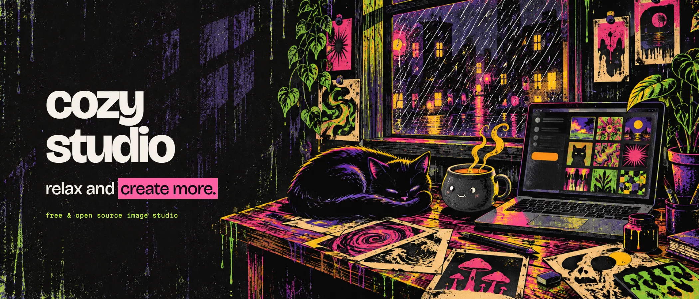
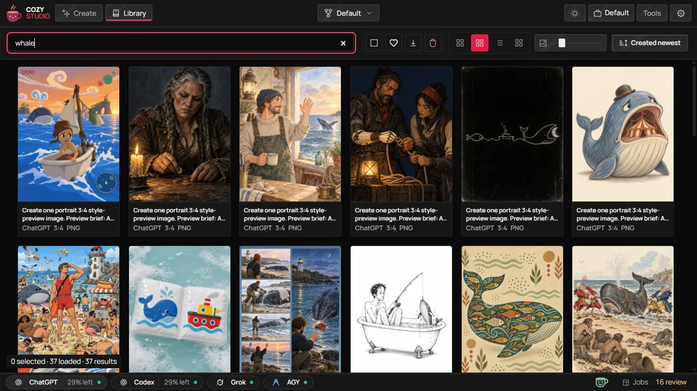
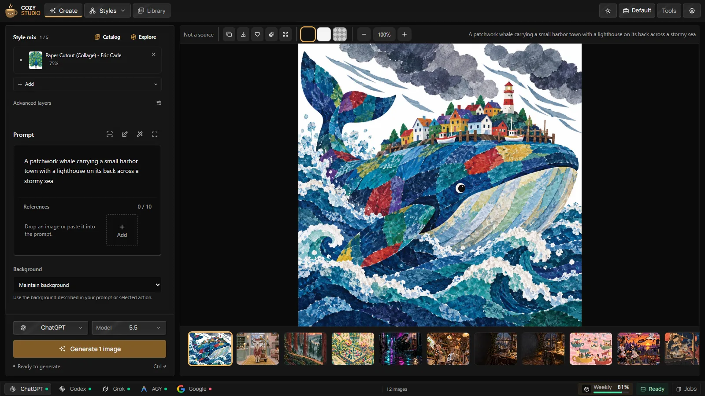
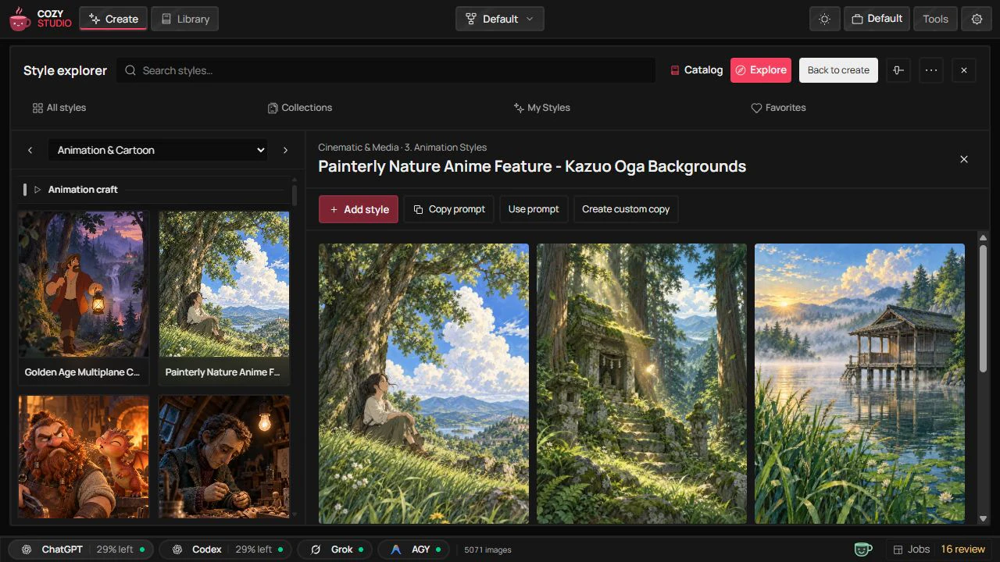
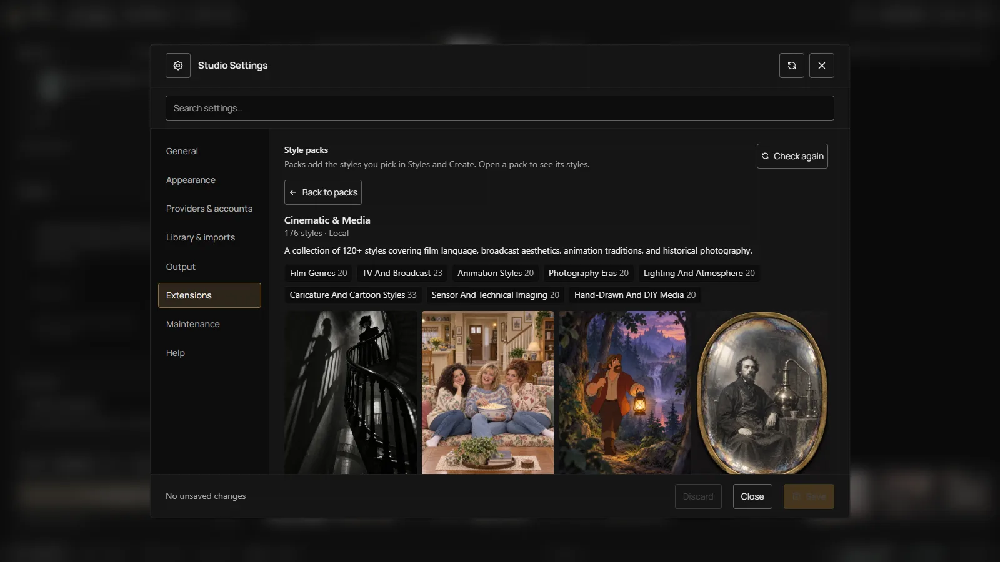
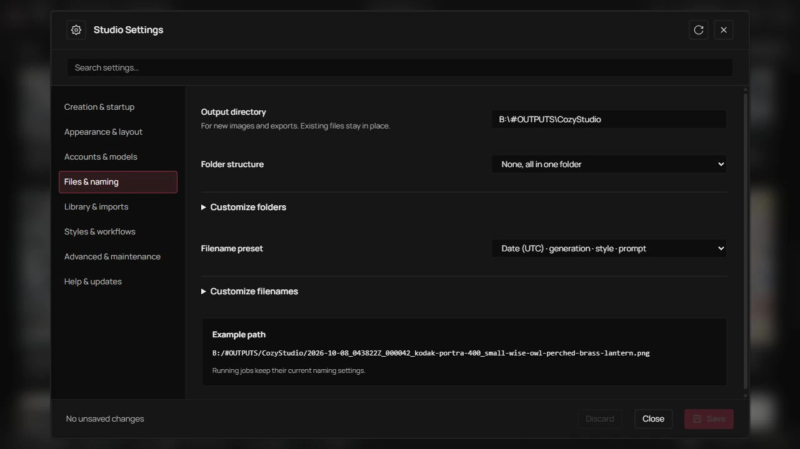
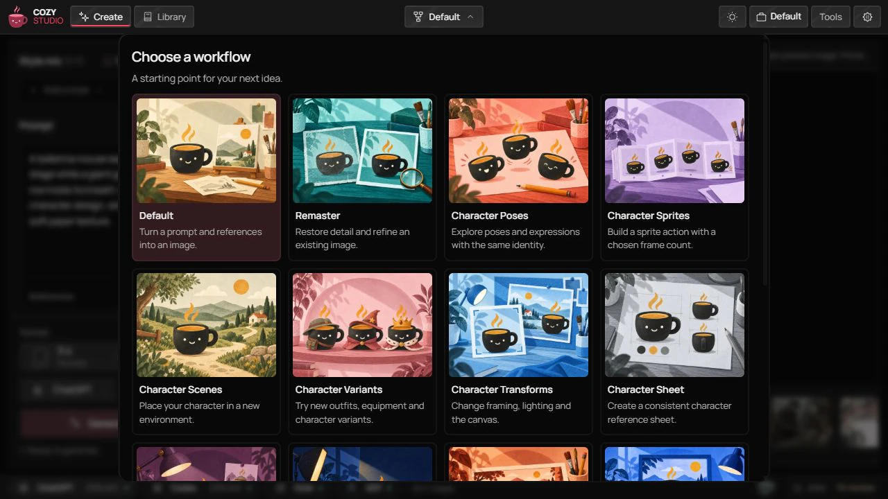
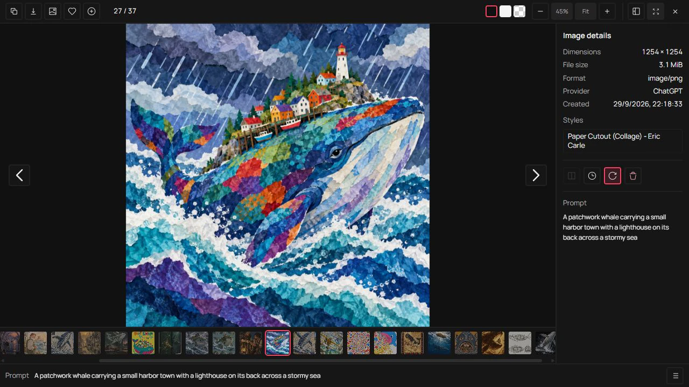

<p align="center">
  
</p>

<p align="center">
  <a href="https://github.com/gvastethecreator/cozy-studio/actions/workflows/ci.yml"></a>
  <a href="https://gvastethecreator.github.io/cozy-studio/"></a>
  <a href="https://bun.com"></a>
  <a href="https://github.com/gvastethecreator/cozy-studio/stargazers"></a>
  <a href="LICENSE"></a>
</p>

**Your ideas, freshly brewed.** Cozy Studio is a free image studio that runs on your own machine. Make images with the subscription you already have (ChatGPT, Grok or Antigravity), pick a style, and keep every result in a folder you can open. No API key is needed for the ChatGPT connection.

[Project site](https://gvastethecreator.github.io/cozy-studio/) · [Source and issues](https://github.com/gvastethecreator/cozy-studio)

<p align="center">
  
</p>

## What you get

- **Styles you can see before you use them.** Style packs hold presets for film stocks, painters, anime studios, pixel art, print processes and more, each with sample cards. Essentials, a curated pack of about 100 styles, installs on first start. Mix up to five styles in one image.
- **Your ChatGPT plan, no API key.** Sign in from Studio Settings and generate with GPT Image models over ChatGPT's own HTTP path. You do not need `OPENAI_API_KEY`, and ordinary jobs do not start `codex app-server`.
- **Files you can find.** Images go to a `Cozy Studio` folder in your Pictures folder, all in one place, named `{timestampUtc}_{generation}_{style}_{prompt}`, for example `2026-10-03_183042Z_000127_kodak-portra-400_retired-lighthouse-keeper-selling-handmade-kites.png`. Sorting by name follows the generation date, time and sequence.
- **Private by default.** The database, thumbnails, logs and sign-in tokens stay in a private app-data folder on your machine. Nothing goes to a hosted library.
- **Workflows beyond a prompt box.** Remaster, Character Lab, Camera View, Cinematic Storyboard, Timeline Frame, Animation Sequence with GIF export, Sprite Sheet and Sprite Atlas.
- **Other providers when you want them.** Codex app-server, Grok Imagine, Google Nano Banana and Antigravity sit behind the same backend.

| Create                                                                                                                          | Style explorer                                                                                                               |
| ------------------------------------------------------------------------------------------------------------------------------- | ---------------------------------------------------------------------------------------------------------------------------- |
|   |      |
| **Style packs**                                                                                                                 | **Files and naming**                                                                                                         |
|                   |     |
| **Workflow picker**                                                                                                             | **Image viewer**                                                                                                             |
|  |  |

Screenshots show the desktop interface on October 8, 2026. Installed packs and results depend on your local library.

## Quick start

You need:

- Bun on `PATH` for source checkouts. Install it yourself from <https://bun.sh/docs/installation>. Each platform-specific portable ZIP includes Bun; Cozy Studio never silent-installs Bun globally.
- A supported provider account for real image jobs. ChatGPT is recommended; sign in through Settings → Accounts & models. That login is not bundled.
- A modern browser.
- Optional, only for the Codex provider: Codex CLI from <https://github.com/openai/codex> with `codex login`.

**From a checkout.** Development also needs Node.js 22 (22.18 or newer), 24 (24.11 or newer) or 26+, as Vite+ requires.

```bash
git clone -c core.longpaths=true https://github.com/gvastethecreator/cozy-studio.git
cd cozy-studio
bun install
bun run studio:onboard --setup
bun run studio:init
bun run dev
```

On Windows, keep `-c core.longpaths=true`. Some workflow asset paths are about 160 characters long, and a clone into a deep folder fails without it.

Then open the UI at <http://localhost:17222>. To update a checkout later, use **Settings → Help & updates**. **Commits on main** is the default; select **Releases** to follow published release tags. Both fast-forward a clean `main`, install dependencies and restart Studio.

**Portable ZIP.** No portable ZIPs are published yet. To get one, prepare a portable UI with `bun run validate:release` and then run `bun run portable:build`. The release gate makes the UI use its own server's port. [Tooling](docs/TOOLING.md) lists the targets for each OS and CPU. Extract the ZIP and follow [PORTABLE.txt](PORTABLE.txt) to launch it. [Platform support](docs/PLATFORMS.md) lists the OS requirements.

The portable root launcher starts `app/`; its default Studio data folder stays beside that folder. Portable updates use published releases, verify the ZIP and replace only `app/`. The first release is planned as `0.1.1` and is unsigned. Read the [first-run and recovery steps](docs/PLATFORMS.md#releases-and-updates).

**Ask an agent.** Open this folder in Claude Code, Codex or Cursor and ask for first setup, or use Copy prompt on the onboarding screen. The prompt points at `skills/cozy-studio-setup/SKILL.md`.

```text
Set up Cozy Studio for first run.
```

After setup, an agent can drive Studio through the `cozy-studio-mcp` server: check readiness, organize Library images with tags and collections, install or update style packs, change settings, generate images and apply app updates. [Agent tools (MCP)](docs/agents/mcp.md) lists the tools and how to register the server.

## First image

1. Sign in with ChatGPT from the welcome screen or **Settings → Accounts & models**. Codex CLI is not required for this connection.
2. Open **Create** and choose **Default** in the workflow picker.
3. Write a prompt. Optionally add a reference or open the style catalog and choose up to five styles.
4. Check the provider and model in the Create footer, then select **Generate**.
5. Find the result in **Library** and in your images folder. Open the viewer to inspect the image, reuse its prompt or download it.

Onboarding shows the images destination and any setup actions that are still necessary. If setup is blocked, see [Troubleshooting](docs/TROUBLESHOOTING.md) or ask an agent to use the [setup skill](skills/cozy-studio-setup/SKILL.md).

Original PNG, JPEG and WebP files can contain the generation prompt and model as metadata. Sharing an original file also shares that text. To remove it, convert the image with metadata turned off.

## Documentation

- [User guide](docs/USER_GUIDE.md): Settings, Library, files, style packs, providers, jobs and updates
- [Troubleshooting](docs/TROUBLESHOOTING.md): blocked setup, provider errors and recovery
- [Contributing](CONTRIBUTING.md) and [Tooling](docs/TOOLING.md): start the app, checks and portable builds
- [All documentation](docs/README.md)

## Status

Cozy Studio is in open-source preview. ChatGPT HTTP is the recommended provider, and the user path is the browser with `bun run dev` or a portable launcher. The [roadmap](ROADMAP.md) lists the current priorities.

For feature requests, open an issue or a pull request. If this project is useful, star it or become a sponsor.

---

<h4 align="right">Support the further development of this tool 🤍</h4>
<p align="right">
  <a href="https://github.com/sponsors/gvastethecreator/"></a>
  <a href="https://ko-fi.com/gvaste"></a>
  <a href="https://x.com/gvastebb"></a>
</p>
