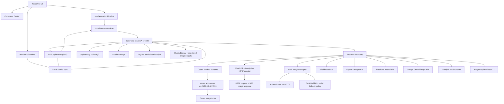

# Architecture

Cozy Studio is a local-first image studio. The React/Vite UI is the main product surface. A local Bun/Hono backend keeps state in SQLite, serves managed assets and sends live events over SSE. Provider adapters own execution. Only the optional Codex route uses `codex app-server`.

This page owns the product boundaries and contracts. The [generated code map](codemap/codemap.md) shows module relationships. [Design](DESIGN.md) owns visual and interaction rules. [CONTEXT.md](../CONTEXT.md) defines the terms. `package.json` owns the versions.

## Product shape

- **Local-first:** SQLite state, references, transcripts, thumbnails and logs live in the Studio Library. Generated images go to the output destination captured at intake, which can be outside that Library. User data stays outside the repository.
- **Catalog-first:** the Image Catalog is the durable and UI truth for images. The former workspace snapshot shape exists only as an explicit export.
- **Provider-aware:** built-in providers run behind backend adapters and do not change the product center. ChatGPT uses its subscription HTTP endpoint and creates no Codex threads. Codex uses local `codex app-server`.

## Frontend seams

- **Shell:** `hooks/useStudioShell.ts` composes the shell. The cross-domain policies live in `hooks/useGenerationQueueController.ts`, `hooks/useCatalogModalDetailHydration.ts` and `hooks/useStudioReset.ts`.
- **Runtime:** `hooks/useStudioRuntime.ts` combines backend health, onboarding, diagnostics and readiness. ChatGPT and Codex usage come from their own sessions. One never fills in for the other.
- **Backend calls:** every call goes through `services/studio-api/` (typed HTTP and errors) or `services/studioEventSource.ts` (the one shared SSE connection). `hooks/useLocalStudioSync.ts` mirrors jobs, logs and catalog changes.
- **Catalog:** `hooks/useCatalog.ts` owns catalog reads, mutations, trash and refresh scopes. `lib/catalogRequestGate.ts` ties each read to a view generation, so a stale response cannot publish into a newer view.
- **Catalog images:** `lib/studioCatalogView.ts` and `lib/studioCatalogImageAdapter.ts` turn Catalog Entries into UI images.
- **Originals:** the image viewer loads the original asset. When it is missing, the viewer shows an error, never a reduced substitute. Thumbnail drags carry only a Catalog Entry ID.
- **Generation:** `services/localGenerationRun.ts` submits an atomic Persistent Job batch and returns catalog-derived results with a complete or partial status.
- **Export:** `lib/studioLegacyWorkspaceSnapshotExport.ts` derives the export-only legacy workspace JSON. There is no browser batch store, import or recovery path.
- **Routes:** `components/shell/StudioViewport.tsx` demand-loads route surfaces. It keeps each lazy component's identity stable after preload, so an open editor is not remounted.
- **Style Packs:** `components/recipes/stylesData.ts` owns the single-flight Style Pack registry and evicts rejected loads. Provider card variants never replace the default card or the Style Preset Manifest.
- **URL state:** `hooks/useLibraryUrlState.ts` owns the Library query parameters. `WorkspaceContext` resolves the URL workspace only after the workspace list loads. An unknown ID becomes `default`.

## Backend seams

All paths are under `apps/local-server/src/`. `appFactory.ts` composes the route modules, and each module owns its domain.

- `jobRoutes.ts` and `persistentJobIntake.ts` own job intake. `providerExecutionPolicy.ts` resolves the execution fields: the explicit request, then the selected provider's default, then the bootstrap fallback.
- `catalog.ts`, `catalogCollections.ts` and `catalogTags.ts` own Catalog Entries and the workspace-scoped collections and tags. A rename updates membership in one transaction. `db/` holds the SQLite connection, the migrations and the domain stores.
- `managedAssetPolicy.ts` validates provider assets against the captured Library root. `workerAssetFinalizer.ts` owns recoverable file, Asset, Catalog and job finalization.
- `worker.ts` runs one Effect `ManagedRuntime`. SQLite stays the job authority. The global and per-provider limits choose which jobs run. Capacity is released only after cleanup and finalization finish.
- `providers/providerEffect.ts` defines the typed failure boundary. Every HTTP body, SSE reader, CLI process, temporary folder and Codex RPC listener has explicit cleanup. Retries stay inside the operations that allow them. Studio never retries a whole job.
- `codex/sessionPool.ts` shares Codex sessions and serializes turns. Each job keeps its captured transport.
- `providerCapabilities.ts` is the fixed non-secret capability catalog. `providers/runtimeConfig.ts` and `grokRuntimeDoctor.ts` own preflight. `providers/providerInputCompiler.ts`, `providers/externalProvider.ts` and `workerRouting.ts` use explicit built-in dispatch.

### Agent gateway

`mcpRoutes.ts` exposes validated tools through the loopback gateway and the stdio bridge in `scripts/studio-mcp.ts`. The **Agent access (MCP)** setting gates every call. [Studio MCP](agents/mcp.md) owns the tools, the access levels, the import limits and the agent HTTP route allowlist.

`referenceImport.ts` owns reference imports:

- It reads files only inside the realpath-resolved `mcpAllowedImportRoots`. An empty list turns off file import. Parent traversal and symlink escapes are rejected.
- Imports need write access, are stored as WebP and keep the source and stored digests.
- A replay reuses the saved catalog identity and starts no job. Providers receive only managed Catalog Entry references.

### Updates

`repositoryUpdates.ts` fast-forwards a clean `main` checkout through `/api/updates`.

- It refuses while jobs are queued or running. It blocks mutations during an update and after a failed install.
- After the install, the backend exits with code 75, and `scripts/dev.ts` restarts only the processes it owns.
- Other launch modes can check for updates but cannot update or restart.

## Generation flow

1. The UI collects the prompt, recipe, attachments, provider, batch count and workspace. `useGenerationPipeline` hands them to the local generation runner. No browser queue owns the job lifecycle.
2. The runner resolves Recipe Module data and builds provider-independent Generation Task Specs. With no active style, Default submits a normal generation. Active styles use the `styles` recipe contract.
3. The backend captures each item's Library Context and execution policy. It commits the requested count, the ordered membership and all jobs in one SQLite transaction before dispatch.
4. The Provider Boundary compiles each spec into provider-specific input. New Codex jobs capture `codex app-server`, and new ChatGPT jobs capture subscription HTTP. Historical jobs keep their captured contract. Other providers run only when a concrete preflight passes.
5. Completed jobs write Local Assets, Catalog Entries, transcripts and logs into the Studio Library. HTTP results keep their original pixels. A different returned aspect ratio is an `asset.dimensions.info` event, not a reason for review.
6. The UI refreshes `/api/catalog` by job ID and shows catalog-derived images.

## Jobs and batches

- `/api/jobs/batches` takes a client request identity. The same payload with the same identity returns the same accepted batch. The same identity with different content is a conflict. A lost acknowledgement triggers reconciliation, not a new generation.
- `job_batches` and `job_batch_members` define the requested membership. Intake queues every accepted member before it sends notifications, so an observer error cannot leave a batch partly dispatched.
- `/api/jobs/batches/plan` runs the same intake and returns each item's provider, model and prompt. It creates no job, calls no provider and rejects inline references.
- Retry failed sends the observed attempt numbers and a request identity. SQLite requeues only the matching attempts that are still failed and archives each earlier snapshot in `job_attempts`. Cancelled or uncertain items do not qualify.
- `/api/jobs/{id}/status` is the compact read that observers use to reconcile. An observation failure is not a job failure.
- A `needs_review` job offers inspection, or Resume when it has a known remote identity. It never authorizes a new provider submission.

## Persistence

- SQLite is the durable source of truth for jobs, cataloged assets, libraries, workspaces, settings, events and system logs. Browser storage keeps only bounded preferences and input state.
- Ordered migrations in `apps/local-server/src/db/migrations.ts` run in a transaction and are recorded in `schema_migrations`.
- Workspace is the top-level catalog scope. Tags and collections organize Catalog Entries inside it. Project routes, contracts, columns and tables are retired.
- `StudioWorkspace` is the shared API contract. Shared Effect schemas validate Workspace and Job intake before route logic runs.
- Persistent Jobs carry an immutable Library context, the output folder and naming captured at submit, and durable finalization checkpoints. Recovery resumes finalization without duplicate records or events.
- `/api/jobs` and `/api/catalog` are summary-first. `/api/jobs` returns all open jobs (`queued`, `running`, `needs_review`) apart from the cursor-paged history. History filters never hide open work.
- Catalog batch mutations emit one scoped `catalog.batch_changed` event. A revision gap on the event stream restarts reconciliation.
- Studio reset and the trash purge need a confirm token in the request body. Without it they answer `confirmation_required` and change nothing.
- External Output Sources are read-only until the user imports selected files as Local Assets.

### Storage locations

- `resolveStudioDataRoot` in `apps/local-server/src/config.ts` resolves the private app-data folder. The Studio Library is its `Library` folder, and extensions are in `Extensions`. [Platform support](PLATFORMS.md#default-paths) has the table for each OS. Internal Library state is under `.studio/`.
- A new library registers `Cozy Studio` in the OS Pictures folder (or `STUDIO_IMAGES_DIR`) as an output-only library and selects it as the output directory. Existing destinations are kept. Without a selected output directory, generations use `outputs/` inside the Studio Library.
- SQLite assigns a continuous output generation number at job admission. The same owner always gets the same number, also after a restart. Existing files are never renamed, and ZIP exports never overwrite entries.

### Extensions and style authoring

- Style packs are Cozy Extensions ([ADR 0011](adr/0011-declarative-extensions-and-style-pack-sources.md)). `extensionRoutes.ts` installs and updates them from local build folders or GitHub release indexes. Extension content stays data only.
- The Intentional style plan compiler lives in `packages/shared/src/styles/`. The UI and the MCP `studio_generate` path compile styles with the same functions and Settings.
- The authoring admin lives in `cozy-styles-dev`. It uses `/api/style-authoring` for text proposals and `/api/extensions/install-local` for local installs. Provider credentials stay in Studio.
- Every install verifies the archive size and SHA-256 and the manifest id and version, keeps ZIP entries inside the extension folder and swaps the folder in one step through one process-wide queue. A failed install leaves the previous version in place.
- A local install (`/api/extensions/install-local`) also checks data-only contents, host compatibility and references. It keeps the previous version until a catalog refresh and a runtime hash readback succeed.

### Image conversion and metadata

- `imageConversion.ts` converts Catalog Entries inside registered source roots. Downloads return bytes without a Catalog Entry. Library copies use exclusive writes in the output destination and register a new Catalog Entry. Source files stay unchanged.
- The asset finalizer embeds the prompt and model in PNG, JPEG and WebP before it measures the file. `providers/jobImageMetadata.ts` uses each provider's prompt compiler and the captured settings.
- `metadataEmbedder.ts` changes container metadata without re-encoding pixels. A metadata error is logged, and the provider's image is kept.

## Readiness

Studio Readiness combines:

- local backend reachability
- Studio Library health
- selected-provider authentication and execution readiness
- for the Codex route only: CLI availability, Runtime Doctor metadata, app-server capability and lifecycle, and Local Codex Session state

Generation readiness belongs to the selected provider. ChatGPT readiness does not depend on local Codex. Neither ChatGPT HTTP nor the Codex route needs `OPENAI_API_KEY`. Codex intake checks the same readiness before it persists jobs, so a known-bad runtime fails fast.

Runtime Doctor probes the resolved stable launcher before fallback candidates. RPC requests have deadlines, and shutdown owns the whole launcher process tree. Grok readiness is provider-scoped, not an onboarding gate. Studio never reads or stores CLI authentication material.

## Shutdown and recovery

- Shutdown stops the job worker before the managed `codex app-server`. Active jobs return to `queued`, and the next startup enqueues them again.
- User cancellation and Studio reset record different reasons. Shutdown does not cancel recoverable remote work.
- ChatGPT and Comfy submission checkpoints prevent a second submission after an uncertain acceptance.
- Finalization completes the file, Asset, Catalog Entry, metadata and event work before the worker releases its capacity.

## Provider Boundary

Generation Tasks and Generation Providers stay separate:

- Recipe Modules produce Generation Task Specs. Recipe Provider Directives are the only recipe text in a new spec. An older spec replays its Recipe Context through the compiler fallback.
- Providers compile specs into Compiled Provider Inputs.
- Provider-specific secrets, SDKs, retries and output discovery stay behind backend adapters.
- Provider Secrets stay out of SQLite-backed Studio Settings, job metadata, logs, transcripts, screenshots and docs.
- Providers return the same local contract: job state, Local Assets, Catalog Entries, metadata, logs and diagnostics.
- Provider assets must already resolve to managed Library outputs, references or masks. Raw caller-controlled filesystem paths never cross the Provider Boundary.
- Per-provider execution defaults contain no secrets. An explicit null clears a stored override.

### Codex and ChatGPT

`packages/shared/src/codexExecutionContract.ts` is the shared execution contract for both routes, including the supported models.

- **Codex:** new jobs use app-server and `providerOptions.codex`. Historical jobs keep their captured transport and options. An explicit Standard speed on an accepted job stays Standard when the global defaults change.
- **ChatGPT:** new jobs use subscription HTTP and `providerOptions.chatgpt`, without the Codex executable. The credential store keeps its internal `codex` identifier, so existing sign-ins stay connected.
- The composer hides resolution controls because the subscription endpoint does not reliably honor the output size. Saved requests keep their captured size contract.
- The public [image generation guide](https://developers.openai.com/api/docs/guides/image-generation) defines the size limits. It does not prove subscription entitlement.
- HTTP persists a submission marker before its single POST. A lost acknowledgement or a restart moves the job to review, with no second POST and no CLI fallback. Only a confirmed rejection permits a new retry.
- Quality is medium; reasoning and speed are provider-managed. Requested canvas dimensions take priority over reference framing in compiled image prompts.
- An auth change never changes the transport of an accepted job. Jobs from before the captured contract need a new, reviewed request.

### Other adapters

- **Grok Imagine** uses authenticated xAI HTTP when ready. The signed-in Grok Build CLI runs only when HTTP is unavailable or the explicit fallback policy allows it. It uses a bounded headless session and an exact `image_gen` or `image_edit` allowlist.
- **Antigravity** runs one sandboxed headless CLI session with one `generate_image` call. Studio stages managed references in a temporary workspace and leaves CLI credentials and history untouched.
- **Untested:** Google, fal.ai, OpenAI Images, Replicate and ComfyUI follow documented API shapes but have not run against the live services. Hosted adapters read keys from backend environment variables only.
- `isUntestedGenerationProvider` in `packages/shared/src/generationContracts.ts` drives the Untested label.

ComfyUI uses one configured API workflow template, and Studio does not start ComfyUI.

- Studio checks the template against the runtime's node definitions and rejects partner nodes (`api_node`).
- It stores a runtime fingerprint and the client prompt ID before it submits once.
- A cancellation must be confirmed for the stored remote ID. An unconfirmed one stays `needs_review`.
- Resume reads the original remote execution and never sends it to a different runtime. Legacy active Comfy jobs without a remote identity move to review during migration and are not resubmitted.

## Demand-mounted surfaces

Heavy or optional UI mounts only when it is visible or the user asks for it.

- Recipe pages are route-lazy. Style catalog search, Style Pack data, YAML parsing, ZIP export and Three.js load on demand.
- Settings, diagnostics and provider internals open from explicit surfaces.
- `ui:chunks:verify` and the source audits in `architecture:source:verify` guard against eager imports.

## Checks and automation

`bun run architecture:verify` runs `bun run lint` (the import rules in `vite.config.ts`), `architecture:source:verify` (the source text rules) and `isolation:verify` together for local use. CI does not call it by name: `validate` runs lint and `architecture:source:verify`, and the full Vitest suite includes the isolation tests.

Scripts and the Codex SDK are automation surfaces for audits, migrations, tests and maintenance, not the product runtime. [Tooling](TOOLING.md) and `package.json` list them.

## Storage maintenance

Settings → Advanced & maintenance opens storage controls backed by `/api/maintenance`: storage audit, inline-payload compaction, thumbnail backfill and tooling-log pruning.

Compaction and backfill stay plans until a write request carries its confirm token. The browser cannot run shell commands. The `storage:*` scripts are the automation equivalent.

## Public site

`landing/` builds the public project site as a separate package. [landing/README.md](../landing/README.md) owns its build and deploy.

## Open-source goals

- Keep setup local-first, with independent ChatGPT HTTP and Codex app-server readiness.
- Keep user assets and runtime state outside the repository.
- Keep provider secrets out of catalog metadata, logs, transcripts, screenshots and docs.
- Prefer deep seams with small interfaces over shallow pass-through modules.
- Make diagnostics actionable for first-time users.
